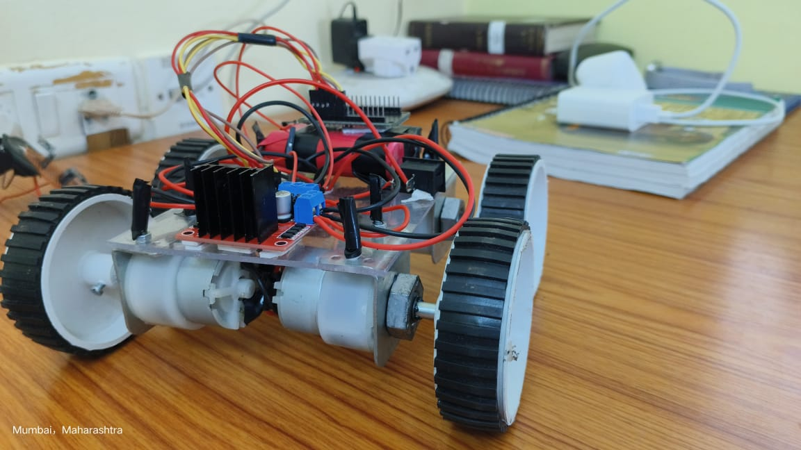
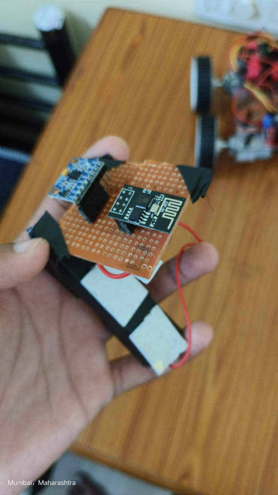
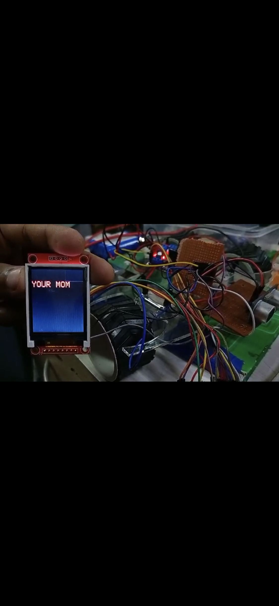

# XLR8 2023: Team Silicon Samurai

A small gesture-controlled robot built with my team in my first semester at
IIT Bombay (September 2023) for XLR8, the Electronics and Robotics Club's
first robotics competition of the year.

<p>
  
  
  
</p>

## What it does

- You drive the robot by tilting a hand-held controller. The controller
  (an ESP-01 with an MPU motion sensor, soldered on perfboard) sends gyroscope
  readings to the robot's ESP32 over ESP-NOW.
- The ESP32 turns the tilt angle into a direction (forward, back, left, right)
  and a speed, and drives the motors through an L298N motor driver.
- An ultrasonic sensor at the front measures the distance to the nearest wall
  and shows it on a 1.8 inch TFT display. Below 5 cm the display shows STOP.

## How it was built

- **Chassis.** Designed in Fusion 360 (with about a day of
  experience in it) and laser-cut from acrylic. The first cut
  was asymmetric and the clamp holes did not line up; the second was too wide.
  The third version, with the clamp holes in the drawing, is the one we used
  (`chassis_design.dxf`).
- **Electronics.** We soldered the controller board (ESP-01 to the motion
  sensor) and the ultrasonic sensor board from the circuit diagrams. The corner
  joints needed reworking before they held.
- **Code.** `bot_receiver/bot_receiver.ino` runs on the robot's ESP32. It was
  written from the competition's template, and some of the template's comments
  are still in it.

## Known issue

The code that should cut the motors when a wall is closer than 5 cm sits after
the `break` statements inside the `switch` in `applyMotorControl()`, so it never
runs. The robot shows the STOP warning but does not stop by itself. I have left
the code as we submitted it.

## Files

```
bot_receiver/bot_receiver.ino   code running on the robot (ESP32)
chassis_design.dxf              final laser-cut chassis
photos/                         robot, controller, sensor board, display
```
